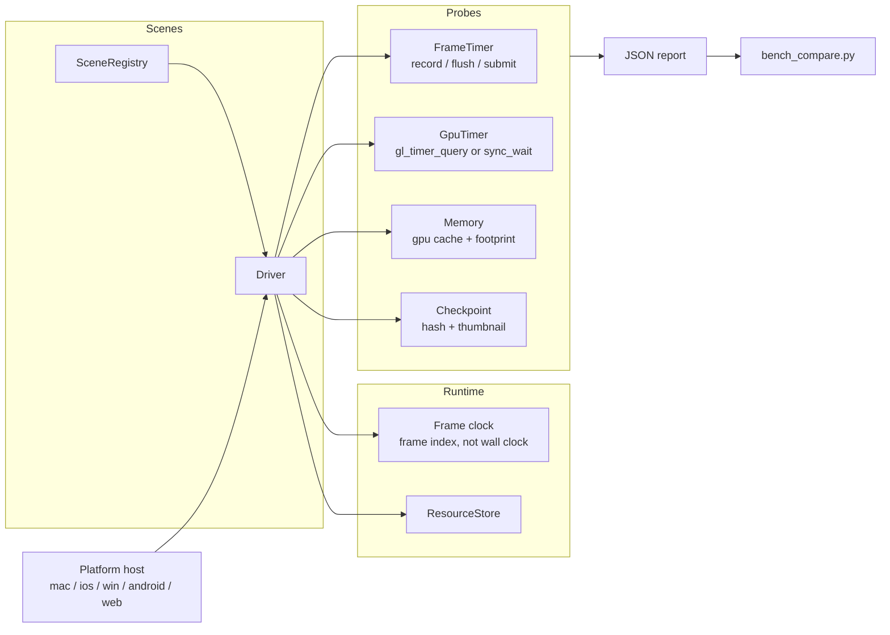

## Introduction

A benchmark project for the [TGFX](https://github.com/Tencent/tgfx) graphics library. It measures
the cost of the paths TGFX is actually used for — motion graphics, UI, vector drawing, infinite
canvas tools and resource heavy apps — on every platform TGFX supports.

There is a related project, [skia-benchmark](https://github.com/libpag/skia-benchmark), which runs
the same benchmark cases against [Skia](https://skia.org/) so the two engines can be compared on
equal footing. You can also run the benchmark online at [tgfx.org](https://tgfx.org/benchmark).

Two things separate this project from a naive frame rate demo:

- **Scenes are measured offscreen**, without a window, without vsync and without the mouse. The
  frame loop is driven by a frame index, not by the wall clock, so a run is reproducible.
- **Timings are attributed.** Every case reports recording, flush, submit and GPU time separately,
  together with the resolved GPU time source, so a regression can be traced to the CPU side or the
  GPU side instead of "it got slower".

---

## Table of contents

- [Repository layout](#repository-layout)
- [Quick start](#quick-start)
- [Architecture](#architecture)
- [Building](#building)
- [Running](#running)
- [Command line reference](#command-line-reference)
- [Scene catalogue](#scene-catalogue)
- [Measurement methodology](#measurement-methodology)
- [Result format](#result-format)
- [Comparing two builds](#comparing-two-builds)
- [Adding a scene](#adding-a-scene)
- [Known limitations](#known-limitations)
- [Troubleshooting](#troubleshooting)

---

## Repository layout

```
src/
  base/                 interactive mode support (AppHost, Bench)
  benchmark/            the legacy ParticleBench used by the interactive and web builds
  core/                 platform independent runtime
    Params.*            parameter set with a stable canonical hash
    Random.h            deterministic RNG shared by all platforms
    Scene.h             scene interface, tiers, module and bottleneck flags
    SceneRegistry.*     registration and glob filtering
    RunConfig.h         mode, sampling and overrides
    MeasureDriver.*     the two pass measuring loop
    Checkpoint.*        rendering equivalence capture
    GpuTimer.h          GPU timing interface
    CaseResultIO.*      cross process result exchange used by --isolate
    Process.*           child process launch
    HeadlessApp.*       mode dispatch, isolation and capacity search
    report/             JSON writer, environment metadata, system info
  scenes/
    prim/  pag/  ui/  vec/  doc/  res/      scene catalogue
    common/DocumentBuilder.*                shared design document builder
  platform/
    mac/  ios/  android/  win/             platform hosts
web/                    Emscripten build of the interactive demo
website/                the tgfx.org packaging of the same demo
tools/
  bench_run.py          interleaved A/B runner
  bench_compare.py      comparability checks and statistics
docs/                   design notes (local only, not tracked)
resources/              assets vendored for the benchmark
```

---

## Quick start

```bash
# 1. fetch tgfx, emsdk and the build tools described by DEPS
./sync_deps.sh

# 2. configure and build for macOS (OpenGL or METAL)
cmake -S . -B ./mac/Release-metal -G Ninja -DCMAKE_BUILD_TYPE=Release -DBENCHMARK_BACKEND=METAL
cmake --build ./mac/Release-metal --target Benchmark -j

# 3. look at what is available
./mac/Release-metal/Benchmark --list

# 4. measure, headless, one case per child process
./mac/Release-metal/Benchmark --mode=measure --suite=smoke --isolate --out=/tmp/result.json
```

Running the binary with no arguments still opens the interactive window, exactly like before.

---

## Architecture



| Layer | Responsibility | Explicitly not responsible for |
| --- | --- | --- |
| Scene | declares its parameter space and tiers, builds deterministic content, updates by frame index | timing, windows, submission |
| Driver | frame loop, warmup and sampling, flush/submit strategy, isolation, capacity search | scene content |
| Probe | records timings, memory, checkpoint images | judging good or bad |
| Report | serialises one run to JSON | statistics |
| Tools | builds, interleaves runs, compares, writes reports | rendering |
| Host | creates the device (windowed or offscreen), parses arguments | measuring |

The runtime never includes a backend header. `CreateHeadlessDevice()` and `CreateGpuTimer()` are the
only two backend specific entry points, each implemented once per platform.

---

## Building

### Prerequisites

Follow [Build Prerequisites](https://github.com/Tencent/tgfx?tab=readme-ov-file#build-prerequisites)
and [Dependencies](https://github.com/Tencent/tgfx?tab=readme-ov-file#dependencies) first. Then:

```bash
./sync_deps.sh
```

This installs the tools listed in `install_tools.sh` and runs `depsync`, which materialises
`third_party/tgfx`, `third_party/emsdk` and `third_party/vendor_tools` at the commits pinned in
`DEPS`. `third_party/` is git-ignored; the pinned version is the one that matters.

To build against a different tgfx checkout, pass `TGFX_DIR` instead of editing anything:

```bash
cmake -S . -B ./mac/Release-metal -G Ninja -DCMAKE_BUILD_TYPE=Release \
      -DBENCHMARK_BACKEND=METAL -DTGFX_DIR=/path/to/tgfx
```

The benchmark compiles tgfx with `TGFX_BUILD_LAYERS` and `TGFX_BUILD_SVG` enabled, because several
scenes use `DisplayList` and `SVGDOM`. Expect the tgfx build to roughly double in time and size.

### Backend selection

The GPU backend is chosen at configure time with `BENCHMARK_BACKEND`, and only with that. Use one
build directory per backend. Passing TGFX internal options such as `TGFX_USE_ANGLE` is rejected
with an explicit error.

| Platform | Supported values |
| --- | --- |
| Windows | `OPENGL`, `ANGLE`, `VULKAN`, `D3D12` |
| macOS | `OPENGL`, `METAL` |
| iOS | `METAL` |
| Android | `OPENGL` |
| Web | `WEBGL`, `WEBGPU` |

`AUTO` resolves to OpenGL on Windows and macOS, Metal on iOS, OpenGL on Android and WebGL on Web.

### macOS

```bash
cmake -S . -B ./mac/Release-opengl -G Ninja -DCMAKE_BUILD_TYPE=Release -DBENCHMARK_BACKEND=OPENGL
cmake -S . -B ./mac/Release-metal  -G Ninja -DCMAKE_BUILD_TYPE=Release -DBENCHMARK_BACKEND=METAL
cmake --build ./mac/Release-metal --target Benchmark -j
```

Reference timings on an Apple M4 Pro, Ninja, 10 jobs: OpenGL 73 s, Metal 2 min 05 s for a clean
build of tgfx plus the benchmark.

If you prefer Xcode, the existing `./gen_mac` script still works and now also accepts the backend:

```bash
./gen_mac -DBENCHMARK_BACKEND=METAL
./gen_mac -a x64 -DBENCHMARK_BACKEND=OPENGL
```

The project is written to `mac/TGFX-Benchmark.xcodeproj`, and the window title shows the backend.

### Windows

```bash
cmake -S . -B ./win/Release-x64-metal ... -DBENCHMARK_BACKEND=D3D12
cmake --build ./win/Release-x64-metal --config Release --target Benchmark
```

Use the Visual Studio toolchain with the Ninja generator (CLion) or the Visual Studio generator,
one build directory per backend:

```bash
cmake -S . -B ./win/Release-x64-opengl -G "Visual Studio 16 2019" -A x64 -DCMAKE_CONFIGURATION_TYPES="Release" -DBENCHMARK_BACKEND=OPENGL
cmake -S . -B ./win/Release-x64-angle  -G "Visual Studio 16 2019" -A x64 -DCMAKE_CONFIGURATION_TYPES="Release" -DBENCHMARK_BACKEND=ANGLE
cmake -S . -B ./win/Release-x64-vulkan -G "Visual Studio 16 2019" -A x64 -DCMAKE_CONFIGURATION_TYPES="Release" -DBENCHMARK_BACKEND=VULKAN
cmake -S . -B ./win/Release-x64-d3d12  -G "Visual Studio 16 2019" -A x64 -DCMAKE_CONFIGURATION_TYPES="Release" -DBENCHMARK_BACKEND=D3D12
```

ANGLE builds copy `libEGL.dll` and `libGLESv2.dll` next to `Benchmark.exe`. Vulkan needs a
Vulkan capable driver and loader. The headless modes are not implemented for Windows yet (see
[Known limitations](#known-limitations)); only the interactive window runs.

### iOS

iOS builds a `Benchmark.app` bundle. The deployment target must be at least 13.0, because tgfx
requires it for Metal.

```bash
NDK=...   # not needed for iOS, shown for symmetry
cmake -S . -B ./ios/build-sim -G Ninja \
      -DCMAKE_SYSTEM_NAME=iOS \
      -DCMAKE_SYSTEM_PROCESSOR=aarch64 \
      -DCMAKE_OSX_SYSROOT=iphonesimulator \
      -DCMAKE_OSX_ARCHITECTURES=arm64 \
      -DCMAKE_OSX_DEPLOYMENT_TARGET=14.0 \
      -DSDK_NAME=iphonesimulator \
      -DCMAKE_BUILD_TYPE=Release \
      -DBENCHMARK_BACKEND=METAL
cmake --build ./ios/build-sim --target Benchmark -j
```

Two flags look redundant but are not:

- `-DCMAKE_SYSTEM_PROCESSOR=aarch64` — tgfx's vendored dependency script only recognises the
  Apple Silicon simulator when the processor is spelled `aarch64`. With `arm64` it silently
  builds device binaries and the final link fails with `building for 'iOS-simulator', but linking
  in object file built for 'iOS'`.
- `-DSDK_NAME=iphonesimulator` — the same script keys the simulator platform off `SDK_NAME`,
  which is empty under Ninja.

If you switch between device and simulator builds, delete `third_party/tgfx/third_party/out`
first. The vendored archives are cached per platform and are not invalidated automatically.

For a device build, use `-DCMAKE_OSX_SYSROOT=iphoneos`, `-DSDK_NAME=iphoneos`, drop
`-DSDK_NAME=iphonesimulator`, and pass a `DEVELOPMENT_TEAM` through
`-DCMAKE_XCODE_ATTRIBUTE_DEVELOPMENT_TEAM=...` when generating an Xcode project.

Run the headless modes inside a booted simulator:

```bash
xcrun simctl boot "iPhone 16 Pro"
xcrun simctl spawn booted ./ios/build-sim/Benchmark.app/Benchmark --list
xcrun simctl spawn booted ./ios/build-sim/Benchmark.app/Benchmark \
    --mode=measure --filter='prim.rect,doc.zoom' --tier=S --frames=10 --repeat=1 --out=/tmp/ios.json
```

On a device `argc`/`argv` are empty, so only the interactive window is reachable. The compiled in
`BENCH_RESOURCES_DIR` points at the host path and is meaningless on device; bundle the assets and
pass `--resources=<bundle path>` when adding a launcher.

### Android

Android produces a shared library that is loaded by the `native_app_glue` activity.

```bash
NDK=~/Library/Android/sdk/ndk/25.2.9519653
cmake -S . -B ./android/build -G Ninja \
      -DCMAKE_TOOLCHAIN_FILE=$NDK/build/cmake/android.toolchain.cmake \
      -DANDROID_ABI=arm64-v8a \
      -DANDROID_PLATFORM=android-24 \
      -DCMAKE_BUILD_TYPE=Release \
      -DBENCHMARK_BACKEND=OPENGL
cmake --build ./android/build --target Benchmark -j
```

The result is `android/build/libBenchmark.so`, an arm64-v8a ELF exporting `android_main`. The
interactive loop is driven at 60 Hz by the host thread; touch input is not wired up yet.

Headless mode exists (`CreateHeadlessDevice()` builds an offscreen EGL pbuffer), but the Android
entry point does not parse arguments, so there is no way to start it from `adb shell`. Wiring that
up needs either intent extras or a configuration file.

### Web

The web build still packages only the interactive demo (the new scene catalogue is not compiled
into it yet), and it is unchanged from before.

```bash
cd web
npm install
npm run build          # WebGL, multithreaded
npm run server         # http://localhost:8061/index.html
```

Other targets:

```bash
npm run build:st              # single threaded
npm run build:webgpu          # WebGPU, multithreaded
npm run build:webgpu:st       # WebGPU, single threaded
npm run build:debug           # dwarf debug info
npm run server:webgpu
```

The build installs and activates Emscripten 4.0.15. The WebGPU page needs a browser with WebGPU
support and must be served from `localhost` or HTTPS.

> **⚠️** In the multithreaded build, if you rename `benchmark.js`, search for the string
> `benchmark.js` inside the generated file and replace every occurrence, otherwise the worker
> fails to start.

To debug C++ in the browser, install
[C/C++ DevTools Support (DWARF)](https://chromewebstore.google.com/detail/cc++-devtools-support-dwa/pdcpmagijalfljmkmjngeonclgbbannb)
and enable **WebAssembly Debugging: Enable DWARF support** in DevTools experiments, then build with
`npm run build:debug`.

---

## Running

### Interactive mode

With no arguments the binary opens the windowed benchmark: a particle stress test that raises the
draw count until the frame rate drops below the target, cycling through rect, circle, oval and round
rect on click. This mode is for looking at, not for collecting data — it is vsync bound and
depends on the window size.

### Measure mode

```bash
Benchmark --mode=measure --out=result.json
Benchmark --mode=measure --filter='pag.*,ui.cards.*' --tier=M,L --repeat=5
```

Each case runs `warmup + frames` frames per repeat, offscreen, at a fixed resolution. The measured
window reports:

- `throughput_ms` — wall clock from the first measured frame to the GPU drain, divided by the
  number of frames. This is the primary metric, because a saturated GPU shows up here as
  backpressure even though individual frame times look fine.
- `frame_ms` — per frame distribution (median, p90, p99, CV, MAD).
- `breakdown_ms` — the same frames split into recording, flush and submit.
- `gpu_ms` — GPU time, with `source` telling you how it was obtained.
- `memory` — tgfx GPU cache and process footprint peaks.
- `checkpoints` — a hash and a thumbnail per checkpoint frame.

### First frame mode

```bash
Benchmark --mode=first-frame --filter='pag.*' --repeat=5 --out=first.json
```

One child process per repeat, each measuring a single frame with a synchronised submit so that
shader compilation, pipeline creation and the first upload are all inside the number. `setup_ms` is
reported separately.

Compare first frame numbers only against runs launched the same way. A binary started from a shell
and the same binary spawned by a parent process differ by an order of magnitude on Metal, because
the driver's pipeline cache state differs.

### Capacity mode

```bash
Benchmark --mode=capacity --filter='prim.rect' --budget=16.67 --out=capacity.json
```

Searches the largest value of the scene's scaling axis whose sustained frame time still fits the
budget. The search grows exponentially until it overshoots, then bisects on a log scale until the
bracket is within 5 %, or twelve probes have been spent. Each probe is a child process.

If doubling the axis value moves the frame time by less than 2 %, the scene has hit a ceiling
(content clipped, culled or saturated) and the result is marked `saturated` rather than reporting a
meaningless number.

### Isolation

```bash
Benchmark --mode=measure --isolate --out=result.json
```

Runs every case in its own child process. Without it, GPU caches of one scene inflate the memory
readings of the next: in a single process the peak footprint of a twelve case run grew from 687 MB
on the first case to 8.3 GB on the last, while the reported GPU cache stayed bounded. With
`--isolate` each case reports its own peak.

`bench_run.py` always launches one process per case, so A/B measurements are isolated by design.

---

## Command line reference

| Option | Meaning |
| --- | --- |
| `--list` | print every scene with its tiers and parameters |
| `--dump-spec` | write the machine readable scene catalogue as JSON |
| `--help` | usage |
| `--mode=measure\|first-frame\|capacity` | select the non interactive mode |
| `--suite=smoke\|core\|full` | preset tiers and sampling (see below) |
| `--filter=<glob,...>` | scene ids, supports a trailing `*`; default is all |
| `--tier=<S,M,L,XL>` | comma separated intensity tiers, default `M` |
| `--resolution=<WxH>` | offscreen size in physical pixels, default `1920x1080` |
| `--density=<float>` | logical to physical pixel ratio used to size content, default `2` |
| `--warmup=<frames>` | warmup frames per repeat, default `60` |
| `--frames=<frames>` | measured frames per repeat, default `300` |
| `--repeat=<count>` | process level repeats, default `5` |
| `--budget=<ms>` | frame budget for capacity mode, default `16.67` |
| `--out=<file>` | result JSON path; printed to stdout when omitted |
| `--checkpoint-dir=<dir>` | write checkpoint thumbnails as raw RGBA next to the JSON |
| `--resources=<dir>` | override the compiled in resource directory |
| `--param=<name>=<value>` | override one scene parameter, repeatable |
| `--no-breakdown` | skip the second, CPU synchronised pass |
| `--no-samples` | omit the raw per-frame samples from the result |
| `--isolate` | one child process per case |
| `--single=<scene>:<tier>` | internal, run exactly one case (used by the isolated and capacity paths) |

### Suite presets

Presets only fill in values that were not given explicitly, so `--suite=core --frames=60` keeps
your frame count.

| Suite | Tiers | Warmup | Frames | Repeats | Intended use |
| --- | --- | --- | --- | --- | --- |
| `smoke` | S | 15 | 60 | 2 | after a change, to confirm nothing broke |
| `core` | M, L | 60 | 300 | 5 | routine A/B before merging |
| `full` | S, M, L, XL | 60 | 300 | 5 | releases and nightly runs |

### Parameter override

```bash
Benchmark --mode=measure --filter=doc.mode_compare --param=mode=direct
Benchmark --mode=measure --filter=ui.cards.canvas --param=cards=2000
```

Values are parsed as boolean, integer, double or string, in that order. Overrides change the
parameter hash, so a run with an override is never compared against a run without it — the
comparison tool reports that instead of silently mixing the two.

---

## Scene catalogue

Thirty eight cases across six categories. Every scene has exactly one scaling axis, so the intensity
ladder and the capacity search have a well defined meaning.

### prim — primitives (baseline and attribution)

| Scene | What it exercises | Axis | S / M / L / XL |
| --- | --- | --- | --- |
| `prim.rect` | solid axis aligned fills, three rotating colours | count | 20k / 240k / 600k / 1.2M |
| `prim.path` | concave star paths through `drawPath` with a per draw transform | count | 100 / 1k / 4k / 16k |
| `prim.gradient` | linear, radial, conic and diamond gradient shaders | count | 16 / 128 / 512 / 2048 |
| `prim.image` | image draws alternating nearest, linear and mipmapped sampling | count | 100 / 1k / 5k / 20k |
| `prim.text` | short CJK or latin text runs at four font sizes | runs | 250 / 1k / 4k / 16k |
| `prim.blend` | full screen translucent rects with advanced blend modes | passes | 4 / 16 / 64 / 256 |
| `prim.stroke` | polylines and curves with mixed widths, caps and joins | count | 100 / 1k / 4k / 16k |
| `prim.clip` | nested rect, round rect and path clips | depth | 32 / 300 / 700 / 1500 |
| `prim.atlas` | `drawAtlas` sprite batch with per sprite tint | sprites | 10k / 60k / 150k / 400k |
| `prim.mesh` | one indexed mesh drawn many times | copies | 64 / 600 / 2000 / 6000 |
| `prim.color_filter` | blend, matrix, luma and composed colour filters on images and shapes | count | 200 / 2k / 8k / 32k |
| `prim.glyphs` | pre-shaped glyph ids drawn with `drawGlyphs` | glyphs | 20k / 150k / 400k / 1M |

### pag — motion graphics (libpag style workloads)

| Scene | What it exercises | Axis | S / M / L / XL |
| --- | --- | --- | --- |
| `pag.blur` | content inside `saveLayer` with a blur image filter | layers | 1 / 2 / 4 / 8 |
| `pag.matte` | alpha mask driven by a radial gradient shader | groups | 16 / 256 / 1k / 4k |
| `pag.shadow` | drop shadow and inner shadow image filters | layers | 4 / 16 / 32 / 96 |
| `pag.image_sequence` | raw RGBA frames uploaded every frame through a per layer ring | layers | 1 / 4 / 16 / 64 |
| `pag.video_yuv` | I420 planes with BT.709 conversion through a per layer ring | layers | 1 / 4 / 16 / 64 |
| `pag.picture` | a recorded `Picture` replayed N times, the libpag playback path | replays | 1 / 4 / 16 / 64 |
| `pag.trim` | `PathEffect::MakeTrim` re-applied to every path each frame | paths | 20 / 100 / 250 / 600 |
| `pag.layer_alpha` | nested `saveLayerAlpha` levels, each carrying its own content | depth | 2 / 8 / 20 / 48 |
| `pag.layer3d` | layers rotated in 3D with `Matrix3D`, per layer alpha and blend | cards | 8 / 32 / 128 / 512 |
| `pag.effect_stack` | image and blended shaders, composed and blended filters, corner path effect, alpha threshold | elements | 6 / 24 / 72 / 200 |

### ui — interface

| Scene | What it exercises | Axis | S / M / L / XL |
| --- | --- | --- | --- |
| `ui.cards.canvas` | cards with shadow, corner radius, title and icon, drawn with Canvas | cards | 20 / 100 / 500 / 2000 |
| `ui.cards.layers` | the same cards built from `ShapeLayer`, `TextLayer`, `ImageLayer` | cards | 20 / 100 / 500 / 2000 |
| `ui.list_scroll` | a long list scrolled through a partially updated `DisplayList` | rows | 50 / 500 / 5k / 20k |
| `ui.glass` | frosted panels using `BackgroundBlurStyle` over moving content | panels | 1 / 4 / 16 / 64 |
| `ui.dashboard` | round rects, circles, ovals, lines, thumbnails, text blobs and vector shapes | cards | 24 / 360 / 1k / 3k |

`ui.cards.canvas` and `ui.cards.layers` are deliberately isomorphic: the difference between them is
the retained layer path, not the content.

### vec — vector drawing

| Scene | What it exercises | Axis | S / M / L / XL |
| --- | --- | --- | --- |
| `vec.svg` | a large SVG document rendered repeatedly | copies | 1 / 2 / 4 / 8 |
| `vec.svg_zoom` | SVG instances scaled continuously, forcing re-rasterization | copies | 64 / 600 / 1500 / 4000 |
| `vec.stroke_heavy` | dense dashed and solid outlines with thick strokes | paths | 100 / 1k / 4k / 16k |

### doc — infinite canvas (Figma style)

| Scene | What it exercises | Axis | S / M / L / XL |
| --- | --- | --- | --- |
| `doc.pan` | a tiled document panned along a deterministic trajectory | layers | 1k / 10k / 100k / 400k |
| `doc.zoom` | 0.1x to 2x and back, re-rasterizing tiles at every step | layers | 500 / 5k / 20k / 80k |
| `doc.edit` | a growing number of layers gets a new fill style every frame | edits | 1 / 10 / 100 / 1000 |
| `doc.overlay` | selection boxes moving on top of a tiled document | selections | 1 / 5 / 20 / 100 |
| `doc.mode_compare` | the same content through Direct, Partial or Tiled | layers | 1k / 10k / 50k / 200k |

### res — resources and lifetime

| Scene | What it exercises | Axis | S / M / L / XL |
| --- | --- | --- | --- |
| `res.decode` | jpg, png and webp bytes decoded and uploaded every frame | decodes | 4 / 16 / 64 / 256 |
| `res.cache_pressure` | many distinct textures with a deliberately small GPU cache limit | images | 8 / 32 / 128 / 512 |
| `res.glyph_churn` | text whose font size changes every frame, defeating the glyph cache | runs | 200 / 1k / 4k / 16k |

---

## Measurement methodology

### Offscreen and deterministic

- The device is created without a window. On macOS and iOS that is `MetalDevice::Make()` or
  `GLDevice::Make()`; on Android it is an EGL pbuffer; on Windows the headless path is not written
  yet.
- The target is a `Surface::Make(context, width, height)`, `1920x1080` by default. Window size,
  display scale and vsync no longer influence the number.
- Scene time is `frameIndex / 60`. Scenes never read the wall clock or the mouse.
- The RNG is a fixed xorshift shared by all platforms. `std::uniform_*_distribution` is avoided
  precisely because its output differs between standard libraries.
- Fonts come from `resources/font`, not from the system, so all three platforms rasterize the same
  glyphs.

### Two passes per case

**Pass A, throughput (primary).** Frames are recorded and submitted without waiting:

```
for frame in [0, warmup + measure):
  update(frame); render()
  record = flush()          -> record_ms
  submit(record)            -> submit_ms
  frame_ms = end - start
flushAndSubmit(sync = true) -> drain
throughput_ms = (drain - first measured frame) / measure
```

When the GPU is the bottleneck the queue pushes back and both `frame_ms` and `throughput_ms`
inflate. This is why `throughput_ms`, not the per frame median, is the primary metric: on
`prim.rect` at one million rects the per frame median reads three times lower than the sustained
cost.

**Pass B, breakdown (diagnostic).** The same scene runs again with `submit(syncCpu = true)` on every
frame, which gives record / flush / submit-and-wait separately. It is capped at 60 frames and can be
skipped with `--no-breakdown`.

### GPU timing per backend

| Backend | Source | Accuracy |
| --- | --- | --- |
| OpenGL (macOS, Android) | `GL_TIME_ELAPSED` queries wrapped around `submit()`, ring of 8, read back only when the driver reports them ready | real GPU time, `source = gl_timer_query` |
| Metal, Vulkan, D3D12, WebGPU | no public timestamp surface in tgfx, so `submit(syncCpu = true)` is timed | upper bound, `source = sync_wait` |

On macOS OpenGL the queries are only enabled when `GL_VERSION` is at least 3.3 or
`GL_ARB_timer_query` is present; otherwise the timer returns null and the driver falls back.

### Checkpoints

At fixed frame indices (default 0 and 59) the frame is read back and reduced:

- a 64 bit FNV-1a hash of the full resolution pixels, used for equality;
- a 64x36 raw RGBA thumbnail (`.rgba`, 9216 bytes) written next to the report;
- a blank flag, set when fewer than 0.1 % of pixels differ from the driver's clear colour.

Checkpoints run in their own pre-pass, before the timed repeats, because a full readback stalls the
pipeline and would otherwise show up as a multi-millisecond outlier.

### Statistics

Reported per case: `throughput_ms` per repeat and their median; `frame_ms` min, median, mean, p90,
p99, max, standard deviation, MAD and coefficient of variation; the same for the breakdown stages;
`gpu_ms` median and p90; `setup_ms`; memory peaks.

Samples are never discarded. The comparison uses medians and rank based tests, which are robust to
outliers, and reports `p99 / median` as a jitter indicator.

### Memory

| Field | Source |
| --- | --- |
| `gpu_cache_bytes`, `gpu_cache_peak_bytes` | `Context::memoryUsage()` sampled every 10 frames |
| `process_footprint_bytes`, `process_peak_bytes` | macOS/iOS `task_info(TASK_VM_INFO)`, Android `/proc/self/status` |

The GPU cache is purged once at the start of each case so every case begins from the same state.
The process footprint is only comparable across cases when `--isolate` is used.

---

## Result format

```json
{
  "schema_version": 1,
  "run_id": "2026-11-09T14:54:24",
  "env": {
    "tgfx_commit": "4d5949b1979f008fdd804f483aa4d0f23d583035",
    "benchmark_commit": "ac746cc",
    "backend": "METAL",
    "build_type": "Release",
    "os": "Version 18.4 (Build 22E238)",
    "cpu": "Apple M4 Pro",
    "gpu_renderer": "Apple iOS GPU",
    "gpu_version": "Metal",
    "gpu_vendor": "Apple",
    "resolution": [1920, 1080],
    "density": 2,
    "thermal_start": "nominal",
    "thermal_end": "nominal"
  },
  "config": {
    "mode": "measure", "suite": "smoke",
    "warmup": 15, "measure": 60, "repeats": 2, "budget_ms": 16.67
  },
  "results": [
    {
      "scene": "prim.rect", "category": "prim", "tier": "M",
      "params": {"antialias": true, "count": 20000, "size": 8.0},
      "param_hash": "a751dc9bb7da84cf",
      "status": "ok", "status_detail": "",
      "setup_ms": 0.19,
      "throughput_ms": {"per_repeat": [0.87, 0.86], "median": 0.865, "blocks": [0.86, 0.87]},
      "frame_ms": {"count": 120, "min": 0.65, "median": 0.77, "mean": 0.82,
                    "p90": 0.95, "p99": 1.68, "max": 1.68,
                    "stddev": 0.18, "mad": 0.06, "cv": 0.22},
      "breakdown_ms": {"record": {"median": 0.48}, "flush": {"median": 0.005}, "submit": {"median": 0.28}},
      "gpu_ms": {"count": 120, "median": 0.75, "p90": 2.46, "source": "gl_timer_query"},
      "first_frame_ms": {"count": 0},
      "memory": {"gpu_cache_bytes": 22618112, "gpu_cache_peak_bytes": 22618112,
                  "process_footprint_bytes": 551470352, "process_peak_bytes": 551470352},
      "checkpoints": [{"frame": 0, "hash": "ee155312124f3a1e", "blank": false, "file": ""}],
      "samples": {"frame_ms": [0.65, 0.67, "…"]}
    }
  ]
}
```

Key details:

- `(scene, tier, param_hash)` is the primary key across builds. Change a scene parameter or a tier
  value and the hash changes, so old data is reported as incomparable instead of silently compared.
- `status` is one of `ok`, `skipped`, `failed`, `blank`, `invalid`.
- `throughput_ms.blocks` holds 30 frame window means, useful for spotting throttling that a single
  per repeat mean hides.
- Capacity results add a `capacity` object: `axis`, `budget_ms`, `metric`, `max_value`,
  `lower_bound`, `upper_bound`, `probes` and `saturated`.
- `--no-samples` drops the raw arrays for smaller files.

---

## Comparing two builds

### `tools/bench_run.py`

```bash
python3 tools/bench_run.py \
    --base ./mac/Release-metal-baseline/Benchmark \
    --head ./mac/Release-metal/Benchmark \
    --rounds 4 --out runs/2026-11-09 --tier=M --warmup=60 --frames=300 --repeat=3
```

Two effects make a naive "run A completely, then run B completely" comparison meaningless:

1. the first process of a binary compiles its pipelines and fills the driver's on disk cache;
2. a long session heats the machine up, so the second half is slower than the first.

`bench_run.py` addresses both: it runs one discarded warm up process per binary, and it alternates
the two binaries **per case**, so the two sides of a comparison are seconds apart rather than
minutes. Use an even number of rounds so that each binary takes the first slot the same number of
times.

Measured effect on an identical binary (A/A), nine scenes, four rounds: before the change the
overall geometric mean drifted to 1.222 with two false positives and one case at 3.9x; after the
change the drift is 1.013 with no false positives.

### `tools/bench_compare.py`

```bash
python3 tools/bench_compare.py base.json head.json \
    --base-checkpoints ckpt-base --head-checkpoints ckpt-head \
    --threshold 0.03 --alpha 0.05 --markdown report.md --html report.html
```

The tool keeps three questions separate:

1. **Comparability.** Same scene, tier and parameter hash; both `ok`; checkpoints identical, or
   equivalent above 40 dB PSNR. A rendering difference is reported and no timing conclusion is
   drawn from that case.
2. **Effect size.** Ratio of the medians of the primary metric, with a bootstrap interval over the
   independent per repeat samples.
3. **Significance.** A sign flip permutation test on the paired per repeat differences, then
   Benjamini-Hochberg correction across all cases so that running thirty scenes does not
   manufacture false positives.

Verdicts: `regression` when the corrected p is below alpha and the ratio exceeds `1 + threshold`,
`improvement` for the mirror case, `neutral` otherwise, `incomparable` when no conclusion is
allowed.

Exit code is non zero when any case regresses, so it can gate CI.

### What the tool can and cannot see

Measured on an M4 Pro with four rounds and three repeats per case:

- A/A over nine scenes: no false positives, overall geometric mean 1.013.
- A consistent synthetic shift of 5 % is detected in 9 of 9 cases, because the paired test removes
  the drift both sides share.
- Absolute per case values still move by up to 30 % between runs on filter heavy scenes such as
  `pag.blur` and `prim.image`. Treat the verdict as trustworthy and the point estimate as an
  indication of magnitude.

If you need tighter absolute numbers, raise `--rounds` and `--repeat`; the variance falls with the
number of independent samples, not with the number of frames inside one repeat.

---

## Adding a scene

A scene is one file plus one line. Implement the interface from `src/core/Scene.h` and register it:

```cpp
namespace benchmark {
namespace {

class MyScene : public Scene {
 public:
  const SceneInfo& info() const override {
    static const SceneInfo sceneInfo = [] {
      SceneInfo result = {};
      result.id = "prim.my_scene";
      result.category = "prim";
      result.description = "What this scene draws";
      result.realWorkload = "Which real workload it stands for";
      result.modules = ModuleCore;                       // ModuleLayers / ModuleSVG when needed
      result.bottlenecks = BottleneckCPURecord;          // bit mask, used for grouping in reports
      result.params = {{"count", int64_t{1000}, "items per frame", true}};
      return result;
    }();
    return sceneInfo;
  }

  ParamSet paramsForTier(Tier tier) const override {
    ParamSet params;
    params.setInt("count", tier == Tier::S ? 100 : (tier == Tier::M ? 1000 : 4000));
    return params;
  }

  bool setup(const SceneContext& sceneContext, const ParamSet& params) override { /* build content */ }
  void update(int64_t frameIndex) override { /* frame index only, no clock, no mouse */ }
  void draw(tgfx::Canvas* canvas) override { /* draw */ }
  void teardown() override { /* release */ }

 private:
  /* members with default member initializers */
};

}  // namespace

BENCH_SCENE(MyScene);

}  // namespace benchmark
```

Rules the catalogue follows, worth keeping:

- exactly one parameter marked `isScalingAxis`, and it must visibly change the work per frame;
- content sized in physical pixels through `sceneContext.density`;
- no wall clock, no global statics that survive between frames, no randomness that is not seeded;
- scenes that render through a `DisplayList` override `render(Surface*)` instead of `draw(Canvas*)`
  and set the display list background to `BenchmarkBackgroundColor()`, otherwise the report's
  checkpoints disagree with the driver's clear colour;
- scenes that change process wide state (a cache limit, for example) restore it in `teardown`.

Because the scenes are linked through an `OBJECT` library, static registration is preserved without
whole-archive flags.

---

## Known limitations

| Area | Limitation |
| --- | --- |
| Windows | Only the interactive window exists; no headless device, so `--mode` is not usable |
| Android | Builds but has not been run; no argument parsing, so no headless entry; no GPU timer (GLES needs `EXT_disjoint_timer_query`) |
| iOS | Resources are compiled in as a host path; a device build needs a bundle and `--resources` |
| Web | Not migrated to the new runtime; still the legacy interactive demo |
| GPU time | Real timestamps only on OpenGL; every other backend reports a synchronised submit upper bound |
| First frame | Dominated by a roughly 85 ms driver initialisation floor, and sensitive to how the process was launched |
| `doc.pan`, `ui.list_scroll` | Tile and partial update caches make these cheap; they measure cache effectiveness more than raw layer count |
| `prim.mesh` | Vertex load saturates quickly on modern GPUs; grows sub linearly |
| Capacity | Probes are short (30 to 60 frames), so a single noisy probe can shift the result one bisection step |
| Noise | Absolute per case values can move by tens of percent run to run; verdicts are paired and robust, point estimates are not |

---

## Troubleshooting

**`third_party/tgfx` is missing.** Run `./sync_deps.sh`, or pass `-DTGFX_DIR=/path/to/tgfx`.

**`TGFX_USE_METAL is not a supported Benchmark configuration entry`.** Only `BENCHMARK_BACKEND` is
accepted. Delete the stale cache entry, or use a fresh build directory.

**iOS link error `building for 'iOS-simulator', but linking in object file built for 'iOS'`.** The
vendored archives were built for the wrong platform. Delete `third_party/tgfx/third_party/out` and
reconfigure with `-DSDK_NAME=iphonesimulator` and `-DCMAKE_SYSTEM_PROCESSOR=aarch64`.

**`TGFX_USE_METAL on iOS requires CMAKE_OSX_DEPLOYMENT_TARGET >= 13.0`.** Add
`-DCMAKE_OSX_DEPLOYMENT_TARGET=14.0`.

**Every case reports `blank`.** The scene drew nothing, or it cleared to a colour different from
the driver's background. Check the checkpoint thumbnails in `--checkpoint-dir`.

**Results differ between two runs of the same binary.** Use `bench_run.py` rather than two manual
runs: it warms up each binary and interleaves per case. Check `thermal_*` in the environment block;
a run that entered a serious thermal state is not comparable.

**Numbers are much lower than expected for a scene.** Check `gpu_ms.source`: with `sync_wait` the
value is an upper bound that includes the driver's submission overhead. On OpenGL you get real
timestamps.

---

## License

BSD 3-Clause. See `LICENSE.txt`.
